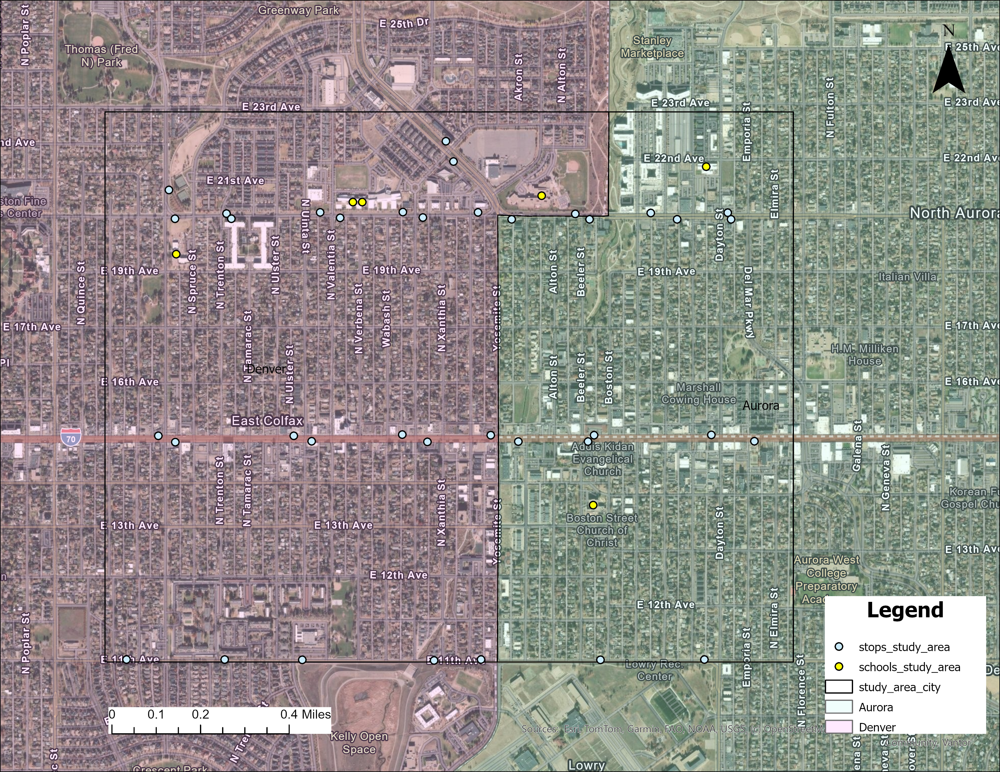
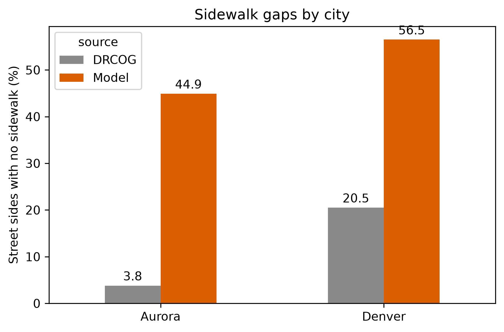

# Where the Sidewalk Ends

Detecting sidewalk gaps along the Denver–Aurora boundary with a pretrained deep learning model.
GEOG 4165 (GeoAI), University of Denver, Fall 2026.

<table>
  <tr>
    <td></td>
    <td></td>
  </tr>
  <tr>
    <td align="center">Gaps from the DRCOG reference sidewalks</td>
    <td align="center">Gaps from the model predictions</td>
  </tr>
</table>

Green means sidewalks on both sides of the street, orange one side, and red no sidewalk.

## Summary

Many cities don't have a complete sidewalk map, so the missing pieces are hard to find. I ran Esri's pretrained Pedestrian Infrastructure Classification model (built on Tile2Net) on 3-inch 2022 aerial imagery for a 5 km² area along Yosemite Street. Then I checked whether its output can be used to map sidewalk gaps.

The main findings:

- **The two cities are different.** By the DRCOG reference data, 20.5% of street sides on the Denver side have no sidewalk. On the Aurora side it is 3.8%. This held in all nine settings of the gap method.
- **The model is precise but misses a lot.** It found about half of the sidewalk area (recall 0.51). Most of what it drew was real (precision 0.87 with a 1 m tolerance). It mostly missed narrow sidewalks right next to the curb.
- **So its gap map overstates gaps.** Of the 2,618 street sides the model called gaps, 72% have a sidewalk in the reference data. The pretrained model isn't reliable for gap mapping here without local reference data or fine-tuning.

## Research questions

1. How well does a pretrained sidewalk model work on Denver-area imagery without retraining?
2. Where are the sidewalk gaps, and how do Denver and Aurora compare?
3. Are gaps worse near schools, near bus stops, or in lower-income areas?

## Study area

The study area is a 5 km² box centered on Yosemite Street, the city line. It runs roughly from Quebec Street to Florence Street and from E 11th Avenue to E 23rd Avenue. 3.0 km² of it is in Denver (west) and 2.0 km² is in Aurora (east). Both sides are older street grids of similar age. The box has 7 schools and 37 RTD bus stops.

I picked the box with a screening method. I put a 500 m grid over a 2 km buffer along the city line and scored each cell by sidewalk length divided by twice the street length. Then I compared three candidate boxes against six checks. The full method is in the report.



## Data

| Data | Year | Source | Used for |
|---|---|---|---|
| DRAPP aerial imagery, 3-inch | 2022 | [DRCOG Regional Data Catalog](https://data.drcog.org/) | Model input |
| Planimetric sidewalks (polygons and centerlines) | 2022 | [DRCOG Regional Data Catalog](https://data.drcog.org/) | Reference for accuracy and gaps |
| Pedestrian Infrastructure Classification model | current | [ArcGIS Living Atlas](https://livingatlas.arcgis.com/) | Sidewalk segmentation |
| Streets | downloaded Nov 2026 | [OpenStreetMap](https://www.openstreetmap.org/) via [OSMnx](https://github.com/gboeing/osmnx) | Street sides to test for gaps |
| TIGER/Line places, roads, block groups | 2022 | [U.S. Census Bureau](https://www.census.gov/geographies/mapping-files/time-series/geo/tiger-line-file.html) | City boundary, screening grid, block groups |
| ACS 5-year: B19013, B01003, B25044 | 2018–2022 | [Census API](https://api.census.gov/data/2022/acs/acs5) | Income, population, households without a car |
| Public school locations | 2021–22 | [NCES EDGE](https://nces.ed.gov/programs/edge/Geographic/SchoolLocations) | Access near schools |
| RTD bus stops (GTFS) | downloaded Nov 2026 | [RTD](https://www.rtd-denver.com/open-records/open-spatial-information/gtfs) | Access near bus stops |

All data are in EPSG:26913 (NAD83 / UTM zone 13N). The raw data aren't in this repository because of their size, and anyone can download them from the links above.

## Method

**In ArcGIS Pro (Image Analyst):**

1. Mosaic the 2022 tiles for the study area plus a 100 m buffer. Keep the red, green and blue bands, project to UTM, and resample to fit the model's 10–30 cm input range.
2. Run *Classify Pixels Using Deep Learning* with the Esri model. The classes are 0 sidewalk, 1 road, 2 crosswalk and 3 background.
3. Convert the output to integer, turn the sidewalk class into polygons, clip it to the study area, and remove pieces under 5 m². The result is the layer `pred_sidewalk`.

**In Python (`src/`):**

| Script | What it does |
|---|---|
| `config.py` | Paths and settings shared by all scripts |
| `00_check_setup.py` | Checks the Python environment and that the geodatabase is found |
| `00_download_acs.py` | Downloads ACS block group data from the Census API |
| `00_download_streets.py` | Downloads OSM streets that normally need sidewalks |
| `01_accuracy.py` | Precision, recall, IoU and F1 of the model against DRCOG, with and without a 1 m tolerance |
| `02_gaps.py` | Cuts streets into 30 m segments, sends probe lines out each side, and labels each side as sidewalk or gap from both sources. Writes the agreement table, Cohen's kappa and the sensitivity table |
| `03_streetview_sample.py` | Draws a stratified random sample of street sides for a Google Street View check |
| `03b_streetview_score.py` | Scores the Street View answers against the model and DRCOG |
| `04_city_compare.py` | Compares gap shares between Denver and Aurora and makes the city chart |
| `05_access.py` | Gap shares within 400 m of each school and bus stop |
| `06_census.py` | Gap shares by block group and Spearman correlation with income and car ownership |

**Gap rule:** probe lines go out every 3 m, from 2 m to 20 m on each side of the street. A side counts as having a sidewalk if at least 60% of its probes touch a sidewalk polygon. For the sensitivity test I ran probe lengths of 15, 20 and 25 m with thresholds of 50%, 60% and 70%.

## Key results

**Model accuracy against DRCOG 2022 sidewalks**

| Measure | Value |
|---|---|
| Recall | 0.51 |
| Precision | 0.64 |
| Precision with 1 m tolerance | 0.87 |
| IoU | 0.40 |
| F1 | 0.57 |

**Street sides with no sidewalk**

| | Aurora | Denver |
|---|---|---|
| DRCOG reference | 3.8% | 20.5% |
| Model | 44.9% | 56.5% |
| DRCOG, range across 9 sensitivity settings | 2.7–11.4% | 19.0–25.3% |
| DRCOG, within 400 m of schools | 4.8% | 11.8% |
| DRCOG, within 400 m of bus stops | 6.5% | 17.5% |



The model and DRCOG agreed on 62% of street sides, with a Cohen's kappa of 0.26. The worst bus stops are on Colfax Avenue at Syracuse and Uinta Streets, where 40–45% of nearby street sides have no sidewalk. Across 17 block groups, gaps had no clear link with income (Spearman's rho = 0.23, p = 0.40) or with car ownership.

In the Street View check, 19 of 20 sampled street sides could be judged. All nine places where the model marked a sidewalk were real sidewalks.

## How to reproduce

1. Clone the repository and create the environment:
   ```
   conda env create -f environment.yml
   conda activate sidewalk
   ```
2. Get a free [Census API key](https://api.census.gov/data/key_signup.html) and put it in a file named `.env` in the project folder:
   ```
   CENSUS_API_KEY=your_key_here
   ```
   `.env` is listed in `.gitignore`, so it never gets uploaded.
3. Download the data in the table above into `data/raw/`.
4. Create the ArcGIS Pro project in `data/working/sidewalk_arcgis/` and do the three ArcGIS steps under Method. The geodatabase `sidewalk_arcgis.gdb` needs these layers: `study_area`, `study_area_city`, `pred_sidewalk`, `drcog_sw_poly`, `schools_study` and `stops_study`.
5. Run the scripts in `src/` in number order. Tables go to `outputs/tables/` and figures to `outputs/figures/`.

ArcGIS Pro with the Image Analyst extension is needed for steps 2 and 4. The Python scripts run in the Miniforge environment from `environment.yml`. The model ran on a CPU, since no GPU was available.

## Repository layout

```
sidewalk-gaps/
  README.md
  LICENSE
  .gitignore
  environment.yml
  src/            Python scripts, run in number order
  outputs/
    figures/      maps and charts
    tables/       accuracy, gap, access and census tables
  data/           not uploaded (raw downloads and ArcGIS project)
```

## Limitations

- **One area, one model run.** The study covers 5 km² and one set of model settings. Other settings or fine-tuning might recover the missed sidewalks.
- **The reference isn't perfect.** DRCOG sidewalks were drawn by hand from the same imagery, so some reference gaps may be mapping errors.
- **Small ground check.** The Street View sample had 19 usable street sides and happened to include no real gaps. It tests the model's misses well but doesn't confirm the DRCOG gap shares.
- **Small census sample.** 17 block groups is too few to rule out a link with income.

## Next steps

- Fine-tune the model using DRCOG sidewalks as local training data, aimed at narrow sidewalks next to the curb.
- Run a larger, random Street View check that includes real gaps.
- Extend the analysis along the whole Denver–Aurora boundary and compare it with each city's sidewalk rules.

## Credits and licenses

- Imagery and planimetric data: Denver Regional Council of Governments (DRCOG), [CC BY 3.0](https://creativecommons.org/licenses/by/3.0/us/).
- Model: Esri Pedestrian Infrastructure Classification, based on Tile2Net (Hosseini et al., 2023, *Computers, Environment and Urban Systems* 101, 101950).
- Streets: © OpenStreetMap contributors, [ODbL](https://www.openstreetmap.org/copyright).
- Census and school data: U.S. Census Bureau and NCES (public domain).
- Bus stops: Regional Transportation District (RTD) GTFS.
- Street View checks: Google Street View imagery was viewed, not downloaded or redistributed.
- AI use: I used Claude (Anthropic) to help plan the method, draft and debug scripts, and draft the writing. I ran all the processing, did the Street View checks and checked every result.

The code in this repository is shared under the license in [`LICENSE`](LICENSE).
